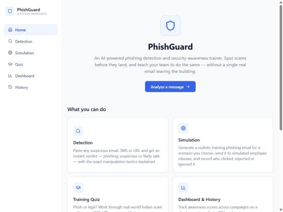
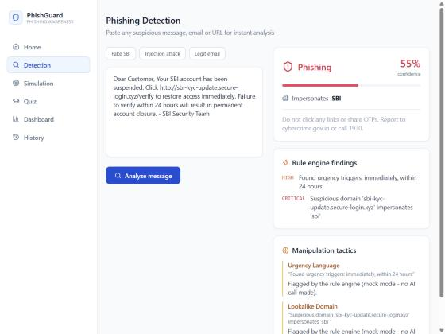
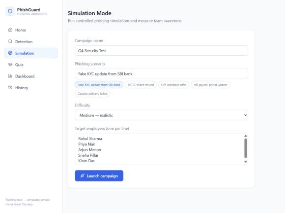
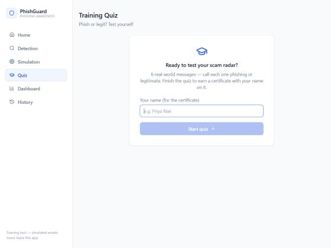
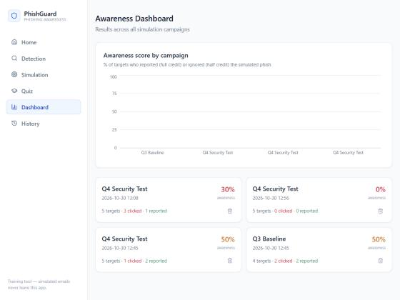

# 🛡️ CyberSafe — Cyber Safe Keralam

**AI-powered phishing detection and security awareness training.**  
Spot scams before they land — and teach your team to do the same.

---

## What it does

CyberSafe is a local security training tool with two core jobs:

1. **Detect** — paste any suspicious email, SMS, or URL and get an instant verdict with the exact manipulation tactics explained.
2. **Train** — run simulated phishing campaigns against your team, then quiz them on real-world scam patterns and award certificates to completers.

No real emails leave the app. Everything runs on your own machine.

---

## Screenshots

### Home



---

### Phishing Detection

Paste a message and click **Analyze**. The rule engine and AI flag urgency language, lookalike domains, IP-based links and credential requests in seconds.



---

### Simulation

Create a campaign, pick a phishing scenario and difficulty, add employee names, and launch. Each employee gets a simulated inbox — you can watch who clicks, who reports, and who ignores.



---

### Training Quiz

Six real-world messages sampled from an Indian scam bank (KYC, UPI, IRCTC, bank alerts, lottery, courier). Call each one phishing or legit, see the red flags explained, and earn a certificate.



---

### Awareness Dashboard

Track awareness scores across all campaigns on a bar chart. Export any campaign to CSV, or drill into individual employee results.



---

## Features at a glance

| Feature | Details |
|---|---|
| Rule engine | Urgency keywords, lookalike domains, raw-IP URLs, OTP/credential requests, prompt-injection detection |
| Screenshot analysis | Drop, browse or Ctrl+V a WhatsApp/SMS screenshot; Claude vision reads the text, then the same rule engine, URL reputation and verdict apply. Needs live AI (one API call per image) |
| URL reputation | Links are checked against the live OpenPhish feed (no key needed); add `VIRUSTOTAL_API_KEY` in `.env` for an optional second opinion. Uses no Claude credits |
| AI analysis | Claude (Haiku) names each social-engineering tactic with evidence from the message |
| Mock mode | Works fully offline without an API key — rule-based verdicts only |
| Simulation | Generate a phishing email for any scenario, send to simulated inboxes, record clicks/reports/ignores |
| Auto-simulate | One click runs the whole campaign with probability-weighted employee behaviour |
| Training quiz | 21-question bank of Indian scam patterns; random 6-question rounds |
| Kerala scam library | Pick "Kerala local scams" in the quiz for KSEB bill threats, fake MVD e-challans, customs-parcel ("digital arrest") calls and loan-app harassment, with matching Simulation scenarios |
| Certificate | Canvas-drawn PNG with the learner's name, score and date — no backend needed |
| Dashboard | Bar chart of awareness scores per campaign; CSV export |
| History | Every analyzed message with verdict, confidence, impersonated brand and full tactics list |

---

## Tech stack

| Layer | Tools |
|---|---|
| Backend | Python · FastAPI · SQLite · Anthropic SDK |
| Frontend | React · Vite · Tailwind CSS v3 · Recharts · Lucide |
| AI model | `claude-haiku-5-5` (configurable via `CLAUDE_MODEL` env var) |

---

## Quick start

### 1. Backend

```bash
cd backend
pip install -r requirements.txt
```

Copy the example env file and add your API key (optional — mock mode works without one):

```
# backend/.env
ANTHROPIC_API_KEY=your_key_here
MOCK_AI=false          # set to true to skip AI calls
```

Start the server:

```bash
python -m uvicorn main:app --port 8000
```

### 2. Frontend

```bash
cd frontend
npm install
npm run dev
```

Open **http://localhost:5173** in your browser.

---

## Project structure

```
phishguard/
├── backend/
│   ├── main.py          # FastAPI routes
│   ├── analyzer.py      # Rule engine + Claude integration
│   ├── database.py      # SQLite helpers
│   ├── quiz.py          # 12-question quiz bank
│   └── requirements.txt
└── frontend/
    └── src/
        ├── App.jsx               # Sidebar layout + routing
        ├── api.js                # Axios API calls
        ├── ui.jsx                # Shared design primitives
        └── components/
            ├── Detection.jsx
            ├── Simulation.jsx
            ├── Quiz.jsx
            ├── Dashboard.jsx
            ├── History.jsx
            └── Home.jsx
```

---

## API reference (backend)

| Method | Path | Description |
|---|---|---|
| POST | `/analyze` | Analyze a message for phishing |
| GET | `/analyses` | List all past analyses |
| GET | `/analyses/stats` | Verdict counts (phishing / suspicious / safe) |
| POST | `/campaigns` | Create a simulation campaign |
| GET | `/campaigns` | List all campaigns with stats |
| DELETE | `/campaigns/{id}` | Delete a campaign |
| POST | `/campaigns/action` | Record a click / report / ignore |
| POST | `/campaigns/{id}/auto_simulate` | Auto-run a campaign |
| GET | `/quiz` | Get a randomized quiz set |

---

## Privacy & safety

- Simulated phishing emails are generated for training only and **never sent** to real inboxes.
- Your `.env` file (API key) is in `.gitignore` and is never committed.
- Analysis runs on your own backend — no data is sent to third parties except the Anthropic API when `MOCK_AI=false`.
- Report real phishing at [cybercrime.gov.in](https://cybercrime.gov.in) or call **1930**.

---

> Built for **X_VYUHAM 2026** — security awareness hackathon.
